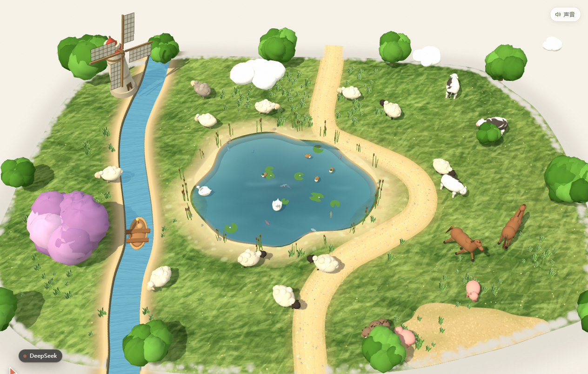

# 小羊牧场 · Little Pasture

**[▶ 在线看 · wfcsilence.github.io/sheep-pasture](https://wfcsilence.github.io/sheep-pasture/)**

一个用 Three.js 做的等距小牧场：草地是蜡笔 + 水彩的纸片平面，动物、树、云、风车、池塘都是立体的，带真实投影。



## 打开

直接双击 `index.html` 就能玩（纯静态，不需要构建、不需要联网，Three.js 在 `vendor/` 里）。
想用本地服务器：

```bash
node serve.js        # http://127.0.0.1:8123
```

## 能做什么

**看**

| 操作 | 效果 |
| --- | --- |
| 什么都不做 | 羊群吃草、溜达、跳跃、趴下；牛反刍；马小跑；猪拱土、打滚；云慢慢飘；风车慢慢转；池塘里天鹅绕圈、鸭子游水偶尔扎猛子、鱼群游来游去；河水一直在流 |
| 滚轮 / 双指捏合 | 放大缩小（0.5×–3.6×），双击复位 |
| 移动鼠标 | 画面轻微视差 |

**点**

| 操作 | 效果 |
| --- | --- |
| 点一只动物 | 蓝色选框（贴合轮廓）+ 尺寸/距离徽标 + 该物种专属工具栏 |
| 羊 Idle / Graze / Walk / Jump | 切换行为 |
| 牛 Graze / Walk / Lie / **Milk** | 挤奶：哞一声，乳滴落下 |
| 马 Graze / Walk / Trot / **Rear** | 人立而起，前腿抬起 |
| 猪 Root / Walk / Roll / **Oink** | 哼唧、拱土冒灰、打滚扬尘 |
| 转一圈 / 复位 / 复制 / 删除 | 转个方向；回出生点；旁边再来一只同种动物；送走它 |
| 点天鹅 | 扇翅膀 |
| 点鸭子 | 慢慢扎进水里，停一会儿再从水面浮起来 |
| 点鱼 | 它浮到水面来绕两圈（金鱼会顺带说一句「我是ZY」） |
| 什么都不做（等一会儿） | 总会有几只动物走到池塘边的浅滩上低头喝水，水面会一圈圈荡开 |
| 点水面 | 一圈水波，附近的鱼受惊散开 |

**画**

| 操作 | 效果 |
| --- | --- |
| 选中动物后点 Walk（按钮会保持高亮），再点草地上任一处 | 它就径直走过去（跨河时会在岸边一个大跳蹦过去）；再点一次 Walk 取消 |
| 在空草地上按住拖一个闭合圈 | 墨迹淡出，圈里冒出一只新动物（58% 羊 / 20% 猪 / 15% 牛 / 7% 马） |
| 点空白处 | 取消选择 |

动物会互相避让、绕开树和风车、不下水、不出岛；走路时腿会摆，吃草低头，跳跃有起跳与落地压缩。
万一有动物被树卡住，它会自己顶出来；实在顶不出来，两秒后会挪到旁边的空地上。

- 初始动物 19 只：11 只羊 + 3 头牛 + 2 匹马 + 3 只猪（池塘里的天鹅、鸭子、鱼另算）。

## 场景里的东西

- 池塘：形状是几层正弦叠出来的自然轮廓（不是正圆），草地贴图上照同一个轮廓挖洞，再嵌入 3D 岸壁、河床和水面（水面向中心渐深）；外圈是一大片沙质浅滩，长着芦苇和石头，动物会走到浅滩边喝水。
- 鱼：灰 3 条、红 3 条、红白 2 条、金 1 条，大小略有差别。
- 河：同样是挖出来的河道，水面下沉；两岸**对称**地铺着砂石浅滩（和池塘岸边同一套砂色 + 石子 + 湿边），水面上有顺流移动的波浪纹理与高光条纹；河上有一只几乎与河面同宽的木船，顺着水流慢慢漂，轻轻摇晃。
- 路：高出草地的一条沙土带，带颗粒和散落的石子，还有 64 颗立体小石头。
- 风车：左上角，石塔 + 红顶 + 四片格子风叶，风叶会慢慢转。
- 高草：20 多片草丛，草高 0.6–1.3，能没过羊腿；芦苇都种在动物进不去的浅滩内圈，不会被踩穿。
- 羊按 4 种固定搭配生成：奶油毛 + 黑脸、奶油毛 + 米色脸、暖灰毛 + 黑脸、深灰毛 + 米色脸（约 38% / 30% / 24% / 8%）。

## 结构

```
index.html          页面骨架 + 全部 CSS + 选框/工具栏/气泡 DOM
js/textures.js      程序化画草地贴图（3000×2100）：水彩底、蜡笔草、树篱影、河道与池塘的洞、小路、沙滩、撕纸边
js/entities.js      羊 / 牛 / 马 / 猪 / 天鹅 / 鸭 / 鱼 / 荷叶 / 芦苇 / 树 / 云 / 风车的低多边形模型
js/app.js           场景、灯光、相机适配、动物状态机、池塘生态、草丛、碰撞、指针交互、缩放
vendor/three.min.js Three.js r128（UMD）
serve.js            可选的静态服务器
sounds/             动物叫声与环境录音（Freesound，见「声音」）
sounds/offline-audio.js  同一批素材的内嵌副本，双击打开时用
```

## 调参入口

都在 `js/app.js` 顶部：

- `W = 74, D = 52` —— 牧场的世界尺寸（越大，相对而言动物越小）
- `TREE_SPOTS` —— 每棵树的位置（uv）、高度、冠幅，紫色樱花树是 `kind: 'purple'`
- 云的字面量数组 `{ x, y, z, s, v }`，`v` 是飘动速度
- `SPECIES` —— 每个物种的缩放、速度、体型半径、状态权重、工具栏按钮、叫声
- 初始动物列表（`/* ---- the opening herd ---- */`）
- `zoomTarget` 上的 `0.5 / 3.6` —— 缩放范围
- `fitCamera()` 里的 `limX / limY` —— 牧场铺满画面的程度（>1 表示出血）

## 说明

- 草地贴图启动时用 Canvas 2D 现画（约 0.5s）；河道和池塘是在贴图上用 `destination-out` 挖洞，再把 3D 的水面/河床/岸壁嵌进去，所以水是"陷下去"的，不是贴上去的。
- 阴影是一张 2048 的 PCFSoft 方向光贴图；云不投影。
- 3210×1827 全屏、29 只动物 + 池塘生态实测约 61fps、约 1400 draw call；常规窗口尺寸下更轻松。

## 细节

- 风车整机朝向池塘，叶片在塔身前侧转动。
- 河道两侧砂石浅滩与池塘边同一套砂色（#b0a074 → #ccba8e 渐变），对称分布。
- 选中动物后点 Walk，按钮单独高亮，其余状态按钮熄灭；此时点草地上的位置，动物会走过去。

## 声音

场景不是静音的。环境声是一段草原夏日录音 + 一段草间风声，循环播放、首尾做淡化；动物叫的是**真实录音**，点击或自己溜达时随机发出，按它在画面里的左右位置做声像、按远近衰减音量。

| 用途 | 素材 | 作者 | 许可 |
| --- | --- | --- | --- |
| 羊 | Sheep_Bleat.wav | n_audioman | CC BY 4.0 |
| 马 | Horse Neigh 2.wav | GoodListener | CC BY 4.0 |
| 鸭 | single quack from a duck | Mikes-MultiMedia | CC0 1.0 |
| 牛 | cows_mooing_mono_4824.wav | Mystikuum | CC0 1.0 |
| 猪 | Pig Oink | qubodup | CC0 1.0 |
| 天鹅 | hissing swan animal field recording | Garuda1982 | CC BY 4.0 |
| 野猪 | Wild Boar / Grunting / Squealing | TheVeoMammoth11 | CC BY 3.0 |
| 环境 | PrairieSummer_ambience.wav | dsebeste | CC0 1.0 |
| 环境 | In the grass.m4a | JeanetteDominguez | CC0 1.0 |

全部素材来自 [Freesound](https://freesound.org)，逐条链接在 `sounds/credits.html`，页面上也有「音效来源」入口。播放时会截取片段、调整音高与时长、加淡入淡出；鱼的水泡和拨水声、风声、鸟鸣、水波仍是 Web Audio 现场合成。

首次点击、按键或滚动会启动音频（浏览器的自动播放限制），右上角「声音」按钮切换静音。双击 `index.html` 时不额外发请求——音频从 `sounds/offline-audio.js` 里的内嵌副本读。

## 在水里画圈

在池塘水面画一个闭合的圈，会随机召唤一只水鸟或鱼（天鹅 12% / 鸭 34% / 鱼 54%），落点会自动避开已有的水鸟与鱼，并保证在池塘内部；水里不会出现陆地动物的落地判定。水鸟和鱼每帧还有一层软分离，彼此不会穿模。

## 许可与致谢

- 场景、模型、贴图、交互代码都是本仓库里手写 / 程序化生成的。
- 唯一的第三方库是 `vendor/three.min.js`（Three.js r128，MIT License）。
- 音效来自 Freesound，逐条作者与许可见上面的表格；CC BY 的素材保留署名，`sounds/credits.html` 与页面上的「音效来源」同样列出。
- 其余代码随便取用、修改。如果拿去做别的东西，跟我说一声我会很高兴。

## 贡献者

- [wfcsilence](https://github.com/wfcsilence) —— 设计、模型、贴图、交互、音效选材
- DeepSeek Harness —— 场景与动画实现、声音混音、文档与发布
